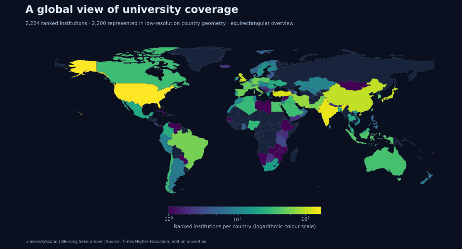
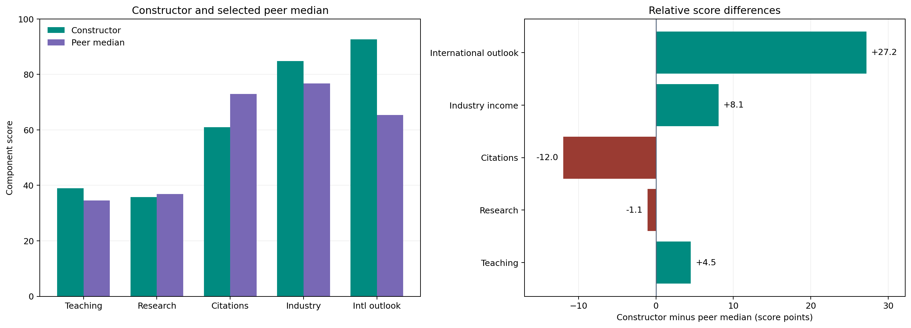
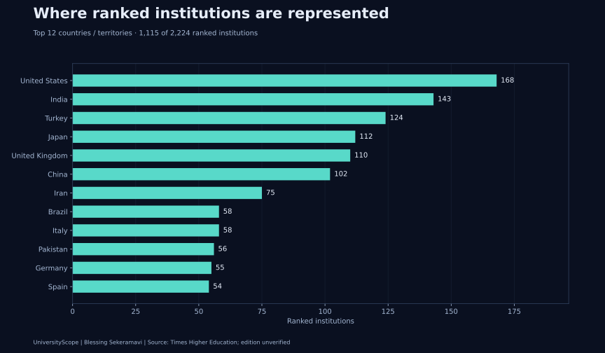
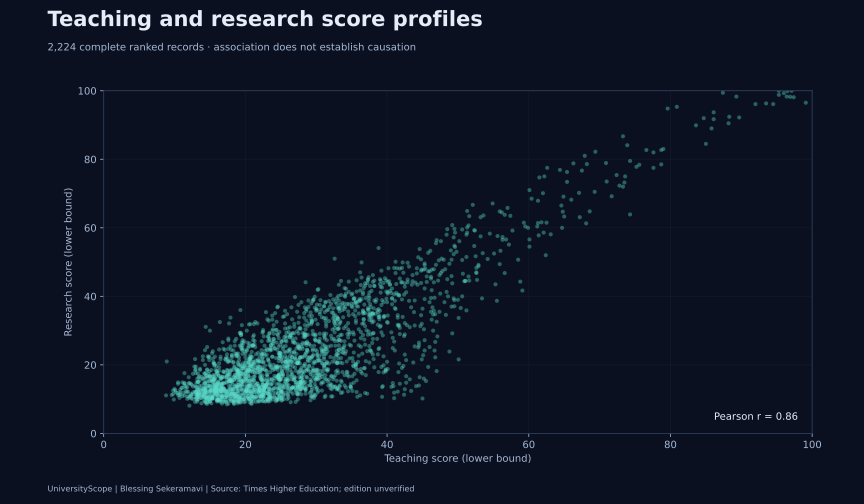
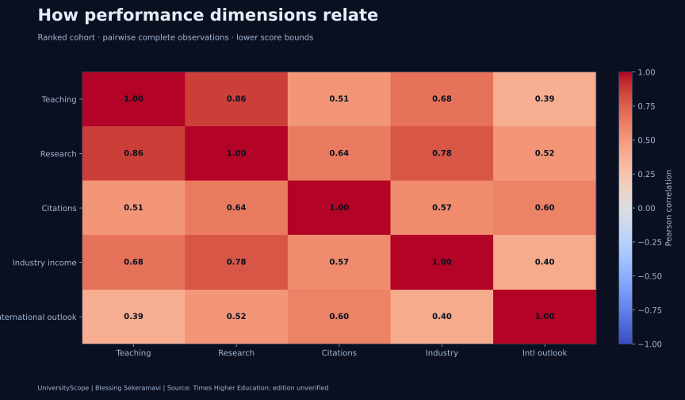
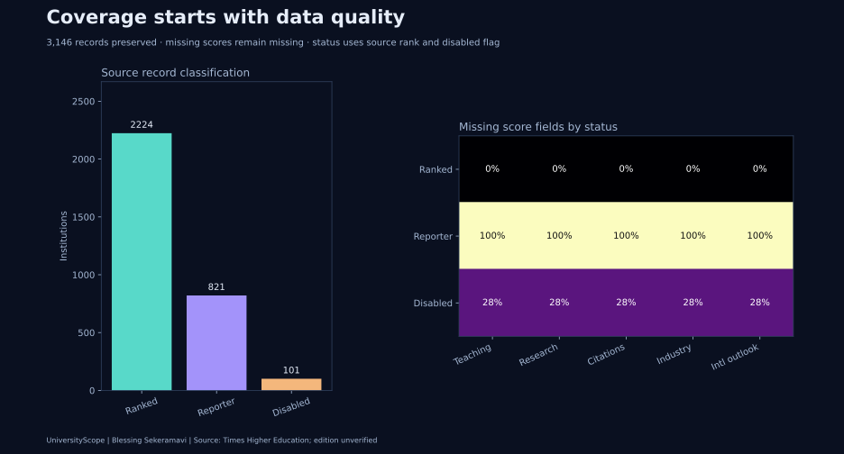
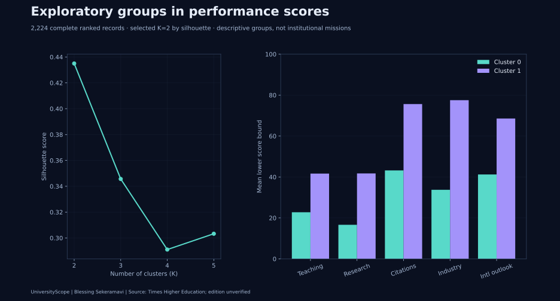

[](https://blessing-universityscope.streamlit.app/)

**[Open the hosted app](https://blessing-universityscope.streamlit.app/)**

# UniversityScope

**Global university performance, geographic coverage and institutional comparison.**

A data science portfolio by [Blessing Sekeramavi](https://github.com/BlessingSK1998), connecting analytical work with international university outreach.

[**Live software demo**](https://universityscope-blessing.pearlypanda9.chatgpt.site) · [**Open interactive dashboard in Colab**](https://colab.research.google.com/github/BlessingSK1998/UniversityScope/blob/main/UniversityScope.ipynb) · [Notebook](UniversityScope.ipynb) · [Methods and data](docs/methodology.md)



## Explore the project

The validation snapshot contains **3,146 records across 131 countries and territories**: 2,224 ranked institutions, 821 reporters and 101 disabled records. All records are retained. The maps show country aggregates rather than campus locations.

- **Interactive maps:** rotating 3D country globe and a projected 2D map with click-to-filter controls.
- **Institution explorer:** search, country and status filters, performance dimensions and CSV export.
- **Comparisons:** up to four institutions, score distributions and fitted cluster profiles.
- **Visual report:** six reproducible charts that display directly on GitHub and in the notebook.

## Featured case study: Constructor University

Compare Constructor with five German peers using a documented rank-band selection rule. The report connects reproducible Python analysis with an Excel workbook and a five-slide briefing.

[**Explore the benchmark**](reports/constructor-benchmark/README.md) · [**Run the benchmark in Colab**](https://colab.research.google.com/github/BlessingSK1998/UniversityScope/blob/main/reports/constructor-benchmark/Constructor_University_Benchmark.ipynb) · [Excel report](reports/constructor-benchmark/Constructor_University_Benchmark.xlsx) · [Slide deck](reports/constructor-benchmark/Constructor_University_Benchmark_Briefing.pptx)



## View the dashboard

For immediate exploration, open the live demo above. To analyze the original dataset in Python:

1. Open the Colab link above.
2. Upload your saved `times_higher_education_rankings.csv` in Colab's Files sidebar, or let the notebook attempt source retrieval.
3. Choose **Runtime → Run all** and scroll to the final dashboard cell.

The notebook contains the project helpers and world boundaries. JavaScript libraries require CDN access. If WebGL cannot start, the dashboard uses its 2D map. Scroll inside the frame for charts, comparisons and the table.

**GitHub displays the static visuals below but does not execute notebook JavaScript.** Download the generated `universityscope_dashboard.html` from Colab to open it in a browser. The [live software demo](https://universityscope-blessing.pearlypanda9.chatgpt.site) uses clearly labelled fictional institutions and supports browser-local CSV import. Your file is read locally rather than uploaded; the original ranking snapshot is not bundled into the website.

## Visual findings





Teaching and research scores have a Pearson correlation of approximately **0.86** in the ranked cohort. This is an association within the ranking data, not evidence of a causal relationship.







Among the tested values K=2–5, **K=2** has the highest silhouette score, approximately **0.435**. Cluster labels describe fitted score groups. They do not establish institutional mission or collaboration fit.

## Run locally

Python 3.10+:

```bash
git clone https://github.com/BlessingSK1998/UniversityScope.git
cd UniversityScope
python -m venv .venv
source .venv/bin/activate
python -m pip install -r requirements.txt
python visuals.py
```

The last command reuses a local CSV or attempts retrieval, generates the six charts and analysis summary, and creates `universityscope_dashboard.html`. Open that HTML in a browser with internet access. Alternatively run `jupyter lab UniversityScope.ipynb`.

## Structure

```text
pipeline.py           Source loading, parsing, validation and provenance
geography.py          Shared country-name resolution
analytics.py          Quality summary and reproducible clustering
visuals.py            Static chart and dashboard generation
dashboard.py          Safe payload generation and notebook embedding
dashboard.html        Interactive dashboard template
build_notebook.py     Portable notebook generation from source files
assets/               Published charts, boundaries and analysis summary
tests/                Python and JavaScript integration tests
docs/                 Methodology, source attribution and limitations
```

After editing source helpers, regenerate the charts and notebook:

```bash
python visuals.py
python build_notebook.py --with-results
python build_notebook.py --check
python -m unittest discover -s tests -v
npm ci
npm test
```

Node is only needed for dashboard integration tests. The dashboard itself runs in the browser. A GitHub Actions workflow runs parser, geography, notebook-format and dashboard interaction checks.

## Data and interpretation

Source: [Times Higher Education World University Rankings](https://www.timeshighereducation.com/world-university-rankings/latest/world-ranking). The original snapshot was retrieved on 16 October 2026. Its content fingerprint is recorded in [analysis-summary.json](assets/analysis-summary.json). The ranking edition is unverified because the acquisition URL uses `latest`.

The maps use Natural Earth country geometry distributed through [world-atlas](https://github.com/topojson/world-atlas). The static overview uses an equirectangular projection; the interactive 2D view uses Natural Earth projection. The ranked cohort contains 2,224 institutions, of which **2,200** are represented by the low-resolution geometry. Small territories and unresolved country names are reported rather than assigned invented locations.

Rank and score bands retain bounds; missing values remain missing and valid zeros are preserved. Raw CSVs are not committed. Review publisher access and reuse terms before acquiring or redistributing data. Rankings support initial screening; partnership readiness needs additional evidence.

## Validation scope

Python tests cover uncertainty, missing values, invalid intervals, status classification, country aliases, date-line geometry and safe HTML embedding. JavaScript integration tests use actual D3 projection and world boundaries with chart rendering stubbed to check filters, comparisons, map clicks and library-failure states. Static charts were visually reviewed. Full browser/WebGL rendering still requires a check in Colab or a browser.
